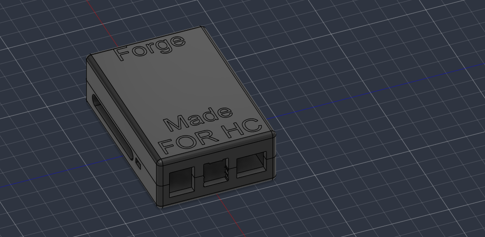

# 🍓 Raspberry Pi 4 Model B Case – Fusion 360

  

  **Designed in Autodesk Fusion 360 | 3D Printable Design**

## 🎥 Design Time-lapse

Watch the design process on YouTube:

[▶️ Watch the Fusion 360 Design Time-lapse](https://youtu.be/42RzXvIpx24)

---

## 🚀 About the Project

This is a custom-designed 3D-printable case for the **Raspberry Pi 4 Model B**, designed entirely in Autodesk Fusion 360.

I wanted to create a case that properly fits my Raspberry Pi while keeping the design clean, practical, and easy to print.

The main focus was to make a compact enclosure that protects the board while providing easy access to all the important ports and connectors.

The case is designed with a separate body and lid, making it easier to assemble, open, and access the Raspberry Pi whenever needed.

## 💡 Why I Made It

I wanted to improve my CAD modelling skills by working on a practical project instead of just designing something for practice.

Rather than using a ready-made case, I decided to design my own from scratch in Fusion 360.

Through this project, I got hands-on experience with:

- Measuring real-world components before modelling.
- Creating precise dimensions in Fusion 360.
- Designing enclosures around existing electronic hardware.
- Creating cutouts for ports and connectors.
- Designing separate parts for easier assembly.
- Preparing CAD models for 3D printing.

## 🛠️ How I Designed It

I designed the case step by step using Autodesk Fusion 360.

**Step 1: Understanding the Raspberry Pi**

I started by looking at the Raspberry Pi 4 Model B dimensions and identifying the important areas that needed to remain accessible, including USB ports, HDMI ports, Ethernet, USB-C power, and GPIO pins.

**Step 2: Creating the Base**

I created the main enclosure using the dimensions of the Raspberry Pi. I designed the internal space to accommodate the board without making the case unnecessarily large.

**Step 3: Adding Port Cutouts**

I created openings around the enclosure to provide access to the Raspberry Pi's ports and connectors. This allows cables to be connected without removing the board from the case.

**Step 4: Designing the Lid**

I designed a separate top cover that fits onto the main body. This makes the enclosure easier to open whenever the Raspberry Pi needs maintenance or modification.

**Step 5: Final Modelling**

After completing the main body and lid, I checked the overall dimensions, clearances, and fitting in Fusion 360.

**Step 6: Preparing for 3D Printing**

Finally, I prepared the individual parts for 3D printing, keeping the geometry simple to reduce unnecessary supports and material waste.

## 🔩 Assembly Guide

The assembly is straightforward and does not require complicated tools.

1. **Prepare the Parts:** 3D-print the main case and the lid. Remove any unwanted printing material and clean the edges.
2. **Prepare the Raspberry Pi:** Check that the Raspberry Pi board is clean and that all the ports are properly aligned.
3. **Place the Board:** Carefully position the Raspberry Pi 4 Model B inside the main case.
4. **Check Port Alignment:** Make sure the USB, HDMI, Ethernet, and power connectors are accessible through their respective openings.
5. **Attach the Lid:** Place the top cover onto the main enclosure and check that it fits properly.
6. **Final Inspection:** Connect the required cables and check that everything fits without interference.

## 🖨️ 3D Printing Settings

| Setting | Recommended Value |
|:---|:---|
| Material | PLA |
| Layer Height | 0.2 mm |
| Infill | 15–20% |
| Supports | Not required |
| Printer Type | FDM 3D Printer |

*These are recommended starting settings; actual results may vary depending on your printer and material.*

## 📁 Project Files

| File | Description |
|:---|:---|
| `pi_case.f3d` | Original Autodesk Fusion 360 source file |
| `pi_case.stl` | Main case – ready for 3D printing |
| `pi_case_lid.stl` | Separate top lid / cover |

## 🔧 Future Improvements

There is always room to improve the design. Some things I would like to explore in future versions:

1. Improved ventilation and airflow.
2. Better cable management.
3. Dedicated mounting options.
4. Improved lid locking mechanism.
5. Additional mounting points for a small cooling fan.

---

## ❤️ Thanks for Checking Out My Project!

This was a fun little project that helped me understand how to turn a real-world requirement into a functional CAD design.

I'm still learning, experimenting, and improving my mechanical design skills through projects like this.

Feel free to explore the files, modify the design, and make your own version!

**Happy Making! 🔧**
